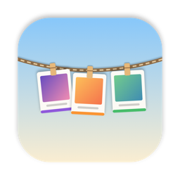
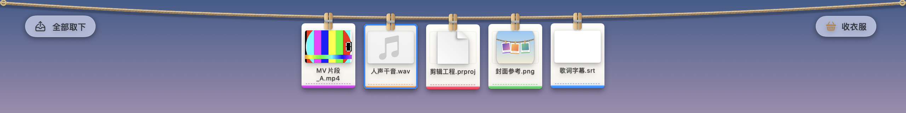
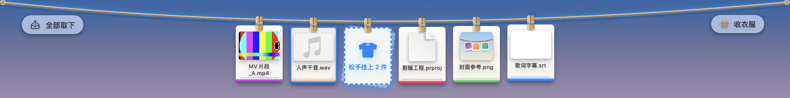

<p align="center">
  
</p>

<h1 align="center">HangDry 晾衣绳</h1>

<p align="center">
  挂在 Mac 屏幕顶部的一根晾衣绳。<br>
  做项目时把散落各处的文件挂上去，随时拖去要用的地方；项目做完<b>一键收衣服</b>，全部整理进一个文件夹。
</p>

<p align="center">
  <a href="README.md">English</a> ·
  <a href="#安装">安装</a> ·
  <a href="#从源码编译">编译</a> ·
  <a href="LICENSE">MIT 协议</a>
</p>



## 为什么做它

做一支 MV，文件会散落得到处都是：渲染输出在一个文件夹，人声干音在桌面，封面参考在下载，歌词字幕又在别处。HangDry 让这些文件在制作期间有个统一的落脚点，项目做完再一键收好。

- **挂上**：把文件拖到屏幕顶部；或者直接复制（⌘C、浏览器里“拷贝图像”、截图到剪贴板），会自动挂上。
- **取用**：从绳上把卡片拖进 Finder、网页上传框、Premiere、DaVinci 或任何 App。
- **收衣服**：选一个文件夹，绳上所有文件按类型移进 `视频/ 音频/ 图片/ 文档/ 工程/ …`，并留一份记录写明每个文件原来在哪。

挂上去只是记下一个链接，原文件在收衣服之前都留在原处。

## 功能

| | |
|---|---|
| **拖上去挂** | 把文件或图片拖向屏幕顶部，晾衣台铺开，光标处空出一个虚线槽位，绳子在那里坠下去，松手就挂在那里 |
| **复制就挂** | 在任何 App 里复制文件或图片都会自动挂上；复制文字不受影响，密码管理器的内容会跳过 |
| **自动挂绳目录** | 监听下载、渲染输出这类目录，新文件写完后自动挂上 |
| **调整位置** | 沿绳子拖动卡片调整顺序，或按类型、创建时间、修改时间、名称排序 |
| **改名** | 给卡片起备注名，原文件名不动；收衣服时可以选择用备注名命名 |
| **取下 / 删除** | 只取下链接，或把真实文件移到废纸篓；也可以一次全部取下，5 秒内可以撤销 |
| **收衣服** | 全部按类型移进一个文件夹，重名自动加序号，留下收衣服记录 |
| **全局快捷键** | ⌃⌥H 一直展开　⌃⌥K 收衣服　⌃⌥⌫ 全部取下　⌃⌥1–4 排序 |
| **物理动效** | 绳子随重量下垂，挂上东西时起伏，衣服挂在衣夹上会晃；全部静止后动画完全停下（空闲约 0.3% CPU） |
| **多语言** | 简体中文、English、繁體中文、日本語 |

<p align="center">
  
</p>

## 安装

需要 macOS 14 Sonoma 或更新版本。

目前还没有签名发布版，请按下面的方法自己编译，然后把 `HangDry.app` 拷进“应用程序”。HangDry 常驻菜单栏（👕），不在程序坞显示。

第一次复制文件或图片时，系统会询问是否允许 HangDry 读取剪贴板。到“系统设置 → 隐私与安全性 → 粘贴”里设为“始终允许”，以后就不会再问。

## 使用

| 操作 | 效果 |
|---|---|
| 拖文件往屏幕上方走 | 绳子正中垂下“拖到这里挂上”的小标签；进入顶部约 44pt 的范围就铺开晾衣台，在上面任何位置松手都行 |
| 按住 ⌥ 松手 | 挂一份副本（存在 App 自己的目录里），而不是链接 |
| 在任何地方复制文件或图片 | 自动挂上（菜单里可以关掉） |
| 鼠标停在菜单栏下方的细绳上 | 绳子展开，鼠标离开后收起 |
| 沿绳子拖动卡片 | 调整位置；用 ⌘/⇧ 多选可以一起挪 |
| 把卡片拖离绳子 | 把文件复制到松手的位置（按住 ⌘ 是移动） |
| 双击卡片 | 打开文件 |
| 右键卡片 | 打开、在 Finder 中显示、改名、从绳上取下、删除文件、排序、收衣服 |
| 绳子左端「全部取下」 | 取下所有链接，原文件不动，5 秒内可撤销 |
| 绳子右端「收衣服」 | 选择目录，文件按类型移进子文件夹 |

卡片底部的色条表示类型：紫=视频、橙=音频、绿=图片、蓝=文档、粉=工程。文件被改名或移动后，卡片会跟到新位置；找不到的文件显示为灰色。

## 从源码编译

需要 Xcode 26 或更新版本，以及 [XcodeGen](https://github.com/yonaskolb/XcodeGen)（`brew install xcodegen`）。

```bash
git clone https://github.com/ansonsiva/HangDry.git
cd HangDry
xcodegen generate          # 根据 project.yml 重新生成 HangDry.xcodeproj
open HangDry.xcodeproj     # 然后运行（⌘R）
```

命令行编译并安装：

```bash
xcodebuild -project HangDry.xcodeproj -scheme HangDry -configuration Release -derivedDataPath build/DerivedData build
cp -R build/DerivedData/Build/Products/Release/HangDry.app /Applications/
```

工程默认用本机临时签名。要发布自己的版本，在 `project.yml` 里换成你的 Bundle ID 和 `DEVELOPMENT_TEAM`，并删掉 `CODE_SIGN_IDENTITY: "-"`。

### 测试

```bash
xcodebuild -project HangDry.xcodeproj -scheme HangDry -derivedDataPath build/DerivedData test
```

约 60 个测试，覆盖归类、收衣服、存储、布局、排序、拖放内容、剪贴板识别、文件承诺和物理模拟。测试 target 直接编译 App 源码（不挂宿主 App），在沙盒外运行。

不启动 App，直接把界面渲染成 PNG：

```bash
TEST_RUNNER_HANGDRY_SNAPSHOT_IN=测试素材目录 TEST_RUNNER_HANGDRY_SNAPSHOT_OUT=build/Snapshots \
  xcodebuild -project HangDry.xcodeproj -scheme HangDry -derivedDataPath build/DerivedData test
```

### 代码结构

```
HangDry/
  App/        HangDryApp（菜单栏入口）、AppModel（状态与所有操作）
  Model/      HungItem、FileKind（类型识别）、RopeStore（书签、沙盒权限、持久化、排序）
  Services/   Collector（收衣服）、FolderWatcher（自动挂绳目录）、ClipboardWatcher（自动挂上复制的内容）、
              DropLoader / ImageClip（读取拖入和复制的文件、图片）、HotKeyCenter（全局快捷键）、ThumbnailCache（Quick Look 缩略图）
  Window/     RopePanel（透明浮动面板）、RopePanelController（展开/收起、晾衣台、鼠标轮询）、
              RopeContainerView（晾衣台背景、AppKit 拖放）
  Views/      RopeView（场景）、RopeSimulation（弹簧、单摆、起伏）、RopeDrawing（麻绳和衣夹）、
              ClothesView、ClothesInteraction（拖拽源与右键菜单）、MenuBarContent
  Resources/  Localizable.xcstrings、PrivacyInfo.xcprivacy、App 图标
HangDryTests/ 单元测试和界面快照
Scripts/      make_icon.swift（绘制 App 图标）
```

### 踩过的坑

代码里相关位置都写了注释，动手改之前值得先知道：

- **WindowServer 负载**：每帧都在变的视图（摆动的卡片、虚线槽位、提示标签）都先用 `drawingGroup()` 在 App 内画成位图。不这样做，WindowServer 会每帧重新光栅化图形、文字和阴影，拖拽时整台 Mac 都会卡。晾衣台背后如果用全屏宽的实时毛玻璃，也是同样的后果，所以晾衣台用的是半透明纯色。
- **拖放与透明度**：macOS 按像素的透明度决定把拖拽交给哪个窗口。窗口大部分透明时，拖拽会在它和下面的 App 之间来回切换、闪烁，所以拖拽经过时晾衣台是不透明的。
- **Swift 6 的隔离检查**：在 `@MainActor` 代码里写、交给 AppKit 接口、会在后台队列回调的闭包，运行时会停在 `_dispatch_assert_queue_fail`。这类回调要在 `nonisolated` 函数里生成，并标成 `@Sendable`（参考 `DropLoader.makeReader`）。
- **文件承诺**（从浏览器、照片、聊天软件拖出来的图片）只能在 `performDragOperation` 里同步发起接收。
- **剪贴板隐私**（macOS 15.4 起）：读取 `changeCount` 和 `types` 不会打扰用户，读取内容会弹窗询问。HangDry 只在类型里有文件或图片时才读取内容。

Debug 版专用的性能检查启动参数：`-demoAnimation`（每隔几秒自动收起再展开）和 `-demoShelf`（模拟拖着文件停在绳上）。

## 沙盒与隐私

HangDry 运行在 App 沙盒里，访问的每个文件都来自你的操作：拖进来、复制、或者你选的目录，并用安全作用域书签保存访问权限。不收集任何数据，也不联网。权限：`app-sandbox`、`files.user-selected.read-write`、`files.bookmarks.app-scope`。

## 后续计划

- 多根绳：一个项目一根
- 衣服太多时自动叠成一摞
- 根据收衣服记录一键还原
- 空格 Quick Look 预览、多显示器
- 自定义归档模板和命名规则
- 自定义快捷键

## 参与贡献

欢迎提 Issue 和 Pull Request。提交 PR 前请先跑一遍测试。新增界面文字用 `String(localized:)` 或 SwiftUI 字面量，这样会自动进入 `Localizable.xcstrings`。

## 许可证

[MIT](LICENSE) © 2026 junzheng
